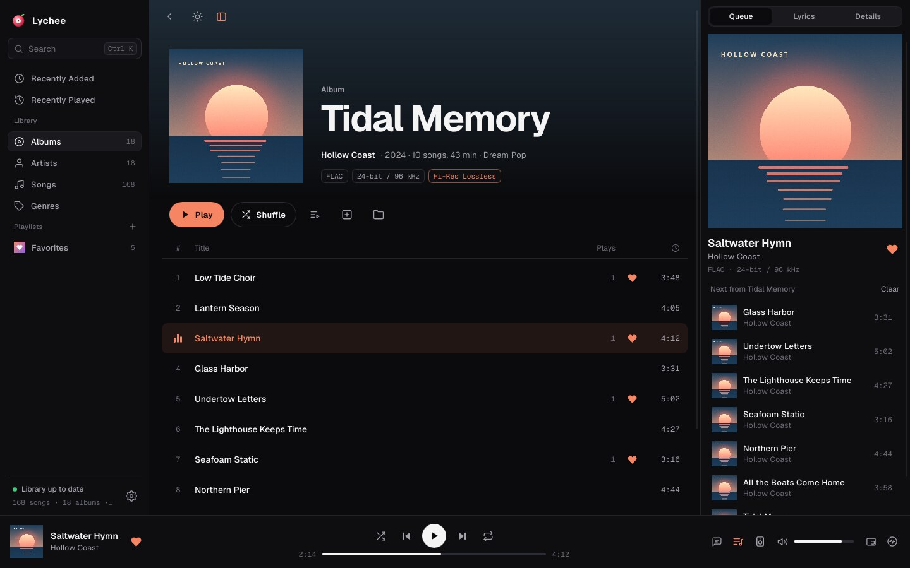
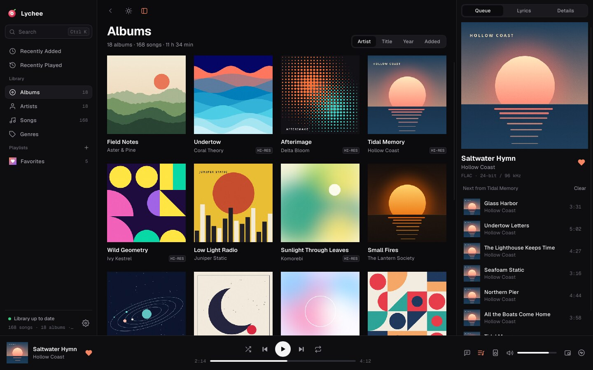
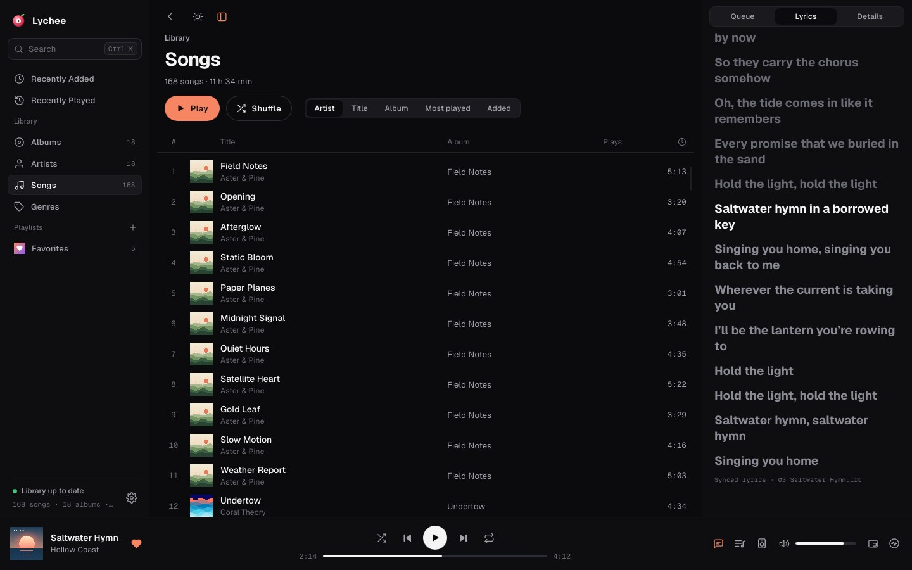
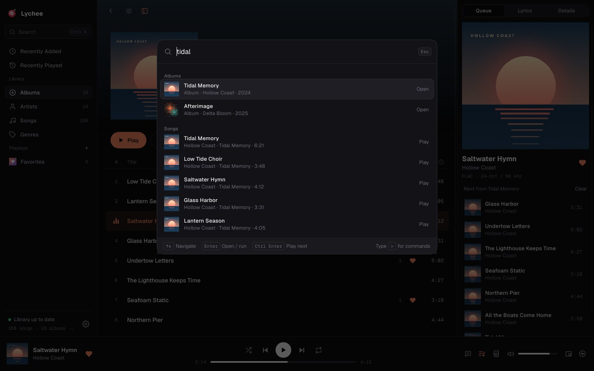
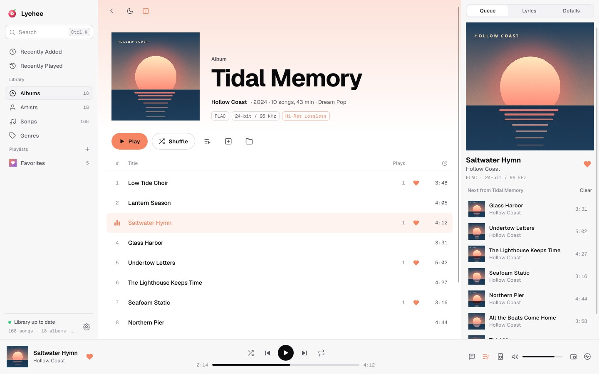
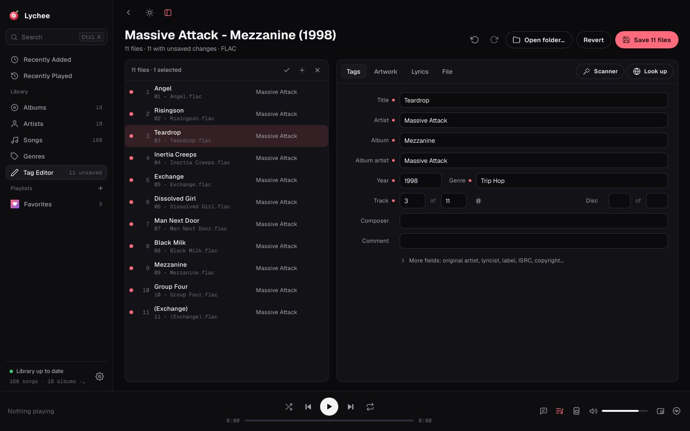
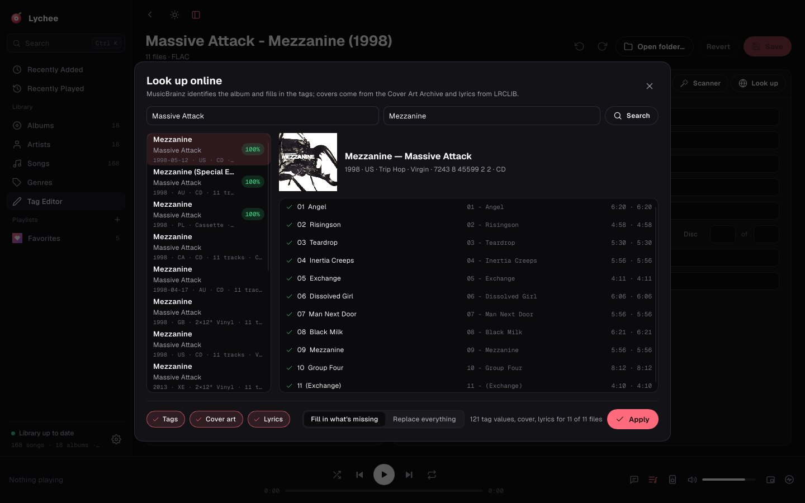
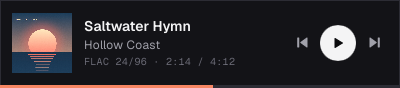

<p align="center"></p>

<h1 align="center">Lychee</h1>

<p align="center">A modern, beautiful music player for your own library on <b>Linux</b> and <b>Windows</b>, written in <b>Rust</b>.</p>



> **Status: v0.1 (early).** Playback, the library, the Flow interface, Last.fm scrobbling and the tag
> editor with online lookups work.
> See [`docs/features.md`](docs/features.md) for what is done and what comes next.

## Features

- **Plays essentially anything:** MP3, FLAC (up to 24-bit/192 kHz), WAV, AIFF, ALAC, AAC/M4A, Ogg Vorbis, Opus, CAF and MKV/WebM audio. Decoding is pure Rust.
- **Gapless playback.** High-quality resampling when your device's rate differs from the file's. Clickless pause, seek and volume.
- **Fast library.** Parallel scanning, incremental rescans, embedded or folder artwork, and compilations grouped as "Various Artists". Browse Albums, Artists, Songs, Genres, Recently Added and Recently Played.
- **The Flow interface.** A three-pane layout, album pages tinted with the colors of their artwork, and a Queue / Lyrics / Details side panel. Dark, light or follow-the-system themes.
- **Command palette (Ctrl+K).** Fuzzy-search your whole library and run any command from the keyboard.
- **Synced lyrics** from `.lrc` files next to your music or embedded in the file. Click a line to jump to it.
- **Queue and playlists.** Play next, add to queue, reorder, Favorites, and playlists you can create, rename and delete.
- **Last.fm scrobbling.** Sign in through the browser, send "now playing" updates, scrobble with an offline queue, and optionally love tracks you favorite. A status icon sits in the bottom-right corner.
- **Tag editor, modelled on EasyTAG.** Edit many files at once (mixed values show as "Multiple values"),
  number tracks, edit artwork and lyrics, and undo anything. Its scanner fills tags from file names
  (`%n - %t`), renames files from tags and cleans up text (Title Case, underscores, spaces). Changes are
  kept as pending until you save, and frames the editor doesn't know (Serato, private ID3 frames) survive.
- **Online lookup.** Lychee works out which album a folder holds from its tags or folder name ("Artist -
  Album (1998)"), finds it on MusicBrainz and matches each file to its track by duration and title. It
  then fills in what's missing (or replaces everything), plus the cover from the Cover Art Archive and
  synced lyrics from LRCLIB.
- **Mini player (Ctrl+M).** A compact bar that stays on top. On Wayland, which has no "always on top",
  it runs through XWayland so it can.
- **Desktop integration.** MPRIS on Linux (media keys, GNOME/KDE media controls, `playerctl`) and System Media Transport Controls on Windows. Drag and drop files to play them, or pass them on the command line.
- **Remembers where you were.** On restart, Lychee restores your queue, the track you were on and its position.

| Albums | Songs and lyrics |
|---|---|
|  |  |
| **Command palette** | **Light theme** |
|  |  |
| **Tag editor** | **Online lookup** |
|  |  |

Mini player: 

*(Screenshots are rendered headlessly with Slint's software renderer; the real app draws artwork with rounded corners.)*

## Install

Download the latest version from the [Releases page](https://github.com/Y2Kwastaken/Lychee/releases/latest):

- **Windows 10/11:** `…-windows-x64-setup.exe` installs Lychee, with no admin rights needed; the
  `…-portable.zip` runs without installing. Nothing else is needed.
- **Ubuntu / Debian:** `sudo apt install ./lychee_…_amd64.deb`. **Fedora / openSUSE:**
  `sudo dnf install ./lychee-….x86_64.rpm`. The package manager pulls in the libraries Lychee uses.
- **Any other Linux:** unpack `lychee-…-linux-x86_64.tar.xz` and run `./install.sh`. It installs missing
  libraries with apt, dnf, zypper or pacman, then Lychee for your user (`--system` for everyone,
  `--uninstall` to remove it, `--dry-run` to see what it would do).

## Building

You need **Rust 1.92 or newer** and a C compiler (SQLite is built from source).

**Linux** additionally needs the ALSA and fontconfig development files:

```sh
# Fedora
sudo dnf install gcc alsa-lib-devel fontconfig-devel
# Debian / Ubuntu
sudo apt install build-essential libasound2-dev libfontconfig1-dev
# Arch
sudo pacman -S base-devel alsa-lib fontconfig
```

**Windows** needs the MSVC build tools (Visual Studio "Desktop development with C++").

Then:

```sh
cargo run --release
# or play files and folders straight away:
cargo run --release -- ~/Music/Some\ Album
# or open them in the tag editor:
cargo run --release -- --edit ~/Music/Some\ Album
```

On first start, add your music folder. Lychee scans it in the background.

**Releases** are built by `.github/workflows/release.yml` when a `v*` tag is pushed. It builds the
`.deb`, `.rpm` and `.tar.xz` on Ubuntu 22.04 (via `packaging/linux/build-packages.sh`), and the Inno
Setup installer and portable zip on Windows (`packaging/windows/lychee.iss`).

### Last.fm

Scrobbling uses the Last.fm API, which requires an API account (free, takes a minute at
<https://www.last.fm/api/account/create>). Either:

- **build it in:** set `LYCHEE_LASTFM_API_KEY` and `LYCHEE_LASTFM_API_SECRET` when compiling, or
- **enter it in the app:** Settings → Last.fm → API account.

Then click **Connect**, approve Lychee in the browser page that opens, and you're done. No password is stored.

## Keyboard shortcuts

| Action | Keys |
|---|---|
| Play / pause | `Space` |
| Previous / next track | `Ctrl ←` / `Ctrl →` |
| Seek −10 s / +10 s | `←` / `→` |
| Volume down / up | `Ctrl ↓` / `Ctrl ↑` |
| Search and commands | `Ctrl K` (or `Ctrl F`) |
| Mini player | `Ctrl M` |
| Toggle the side panel | `Ctrl Q` |
| Settings | `Ctrl ,` |
| Back / close | `Esc` |
| Tag editor: save / undo / redo | `Ctrl S` / `Ctrl Z` / `Ctrl Shift Z` |
| Tag editor: select all files | `Ctrl A` |

## Where Lychee keeps things

| | Linux | Windows |
|---|---|---|
| Settings | `~/.config/lychee/config.toml` | `%APPDATA%\Lychee\config\config.toml` |
| Library database, scrobble queue | `~/.local/share/lychee/` | `%APPDATA%\Lychee\data\` |
| Artwork cache | `~/.cache/lychee/` | `%LOCALAPPDATA%\Lychee\cache\` |

Set `LYCHEE_HOME=/some/folder` to keep everything in one place (portable installs, testing).
Lychee only changes your music files when you save in the tag editor.

## Project layout

```
crates/
  lychee-core      domain model, play queue (shuffle, repeat, play next), formatting helpers
  lychee-audio     playback engine: Symphonia + pure-Rust Opus, rubato resampling, gapless, cpal output
  lychee-library   scanning, tags (lofty), artwork + colors, SQLite store, fuzzy search, lyrics
  lychee-lastfm    Last.fm auth, now playing, scrobbling with an offline queue
  lychee-platform  MPRIS (Linux) and System Media Transport Controls (Windows)
  lychee-tagger    tag editor engine: lossless tag writing, EasyTAG masks, text clean-up, undo
  lychee-lookup    MusicBrainz, Cover Art Archive and LRCLIB clients, album detection and matching
packaging/         Linux installer and packages, Windows installer and icon, release notes
  lychee           the app: Slint UI (ui/), controller, settings, mini player
design/            interactive design prototypes (the app implements direction D, "Flow")
docs/              features, architecture and technology notes
```

The design is documented in [`docs/architecture.md`](docs/architecture.md). Every UI callback becomes an
action handled by one controller, and each subsystem sits behind its own crate so it can be extended or
replaced.

**Developer tips:** `LYCHEE_SCREENSHOT=out.png LYCHEE_SCREENSHOT_SCENE="page:songs" cargo run` renders the
UI headlessly to a PNG (see `crates/lychee/src/screenshot.rs`).
`cargo run -p lychee-tagger --example tag -- FILE title=Hi` prints or edits a file's tags, and
`cargo run -p lychee-lookup --example lookup -- "Artist" "Album"` tries a live lookup.

## License

Lychee is licensed under the [Apache License 2.0](LICENSE).

- The UI is built with [Slint](https://slint.dev), used under the Slint Royalty-free License 2.0. Its
  attribution appears in Settings → About.

  [](https://slint.dev)
- Bundled fonts: [Geist and Geist Mono](https://github.com/vercel/geist-font), SIL Open Font License 1.1 (`crates/lychee/ui/fonts/OFL.txt`).
- Icons are Feather-style outlines drawn for Lychee.
- Notable dependencies: Symphonia (MPL-2.0), cpal, rubato, lofty, rusqlite, opus-decoder, mpris-server (MPL-2.0), nucleo-matcher (MPL-2.0).
- Online data comes from [MusicBrainz](https://musicbrainz.org) (CC0), the
  [Cover Art Archive](https://coverartarchive.org) and [LRCLIB](https://lrclib.net). Lookups only run when you ask
  for them, and Lychee respects MusicBrainz's limit of one request per second.
