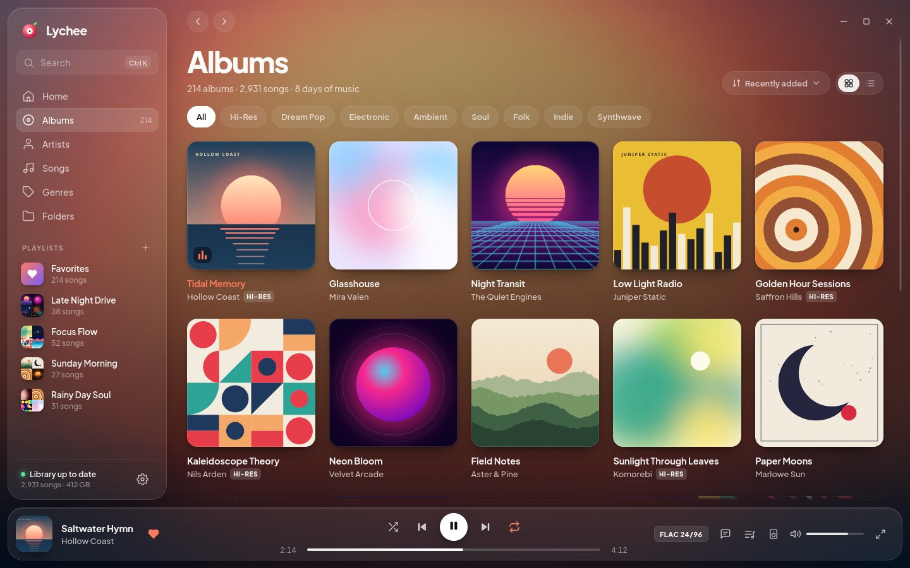
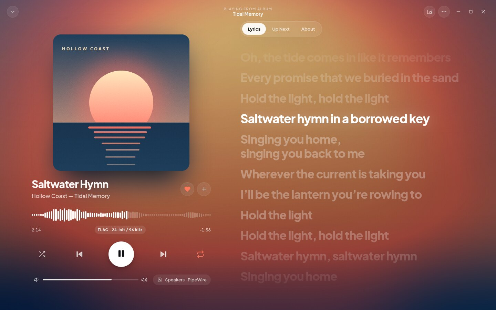
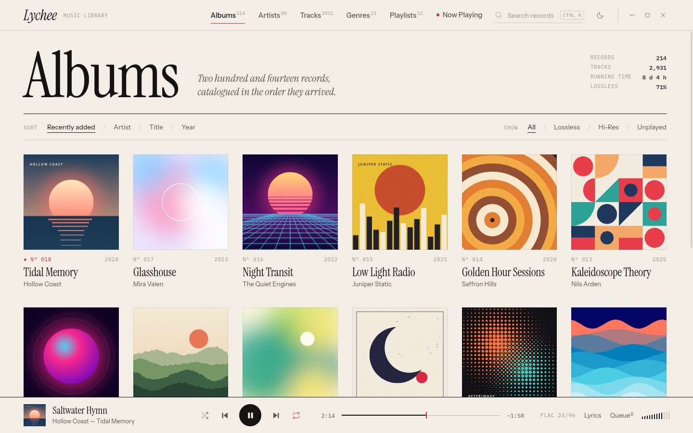
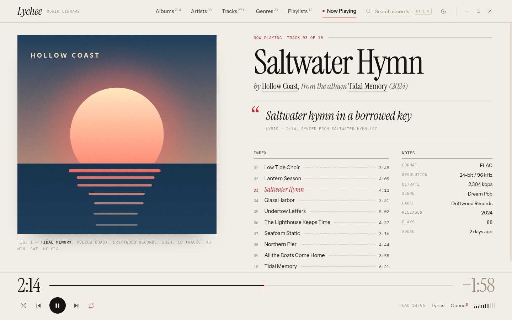
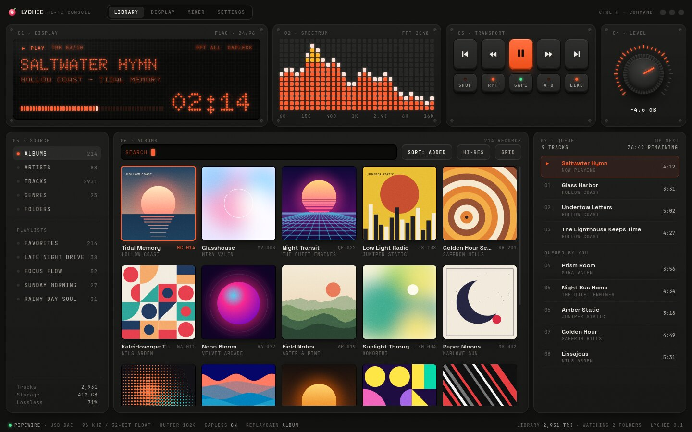
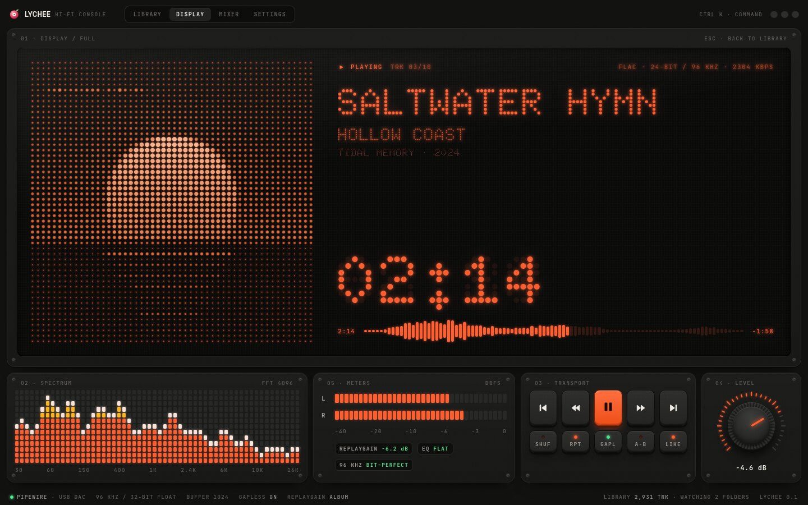

# Lychee: design directions

> **Chosen: D · Flow** (with the Flow mini player). It is implemented in `crates/lychee/ui/`. Streaming-service
> elements were removed for a local player: no "You might also like" row and no "Listen Now" home. The album
> page shows "More by {artist}" only for other albums you own.

Four directions were explored for Lychee's UI. Each one is an **interactive HTML prototype** you can click through, not just a picture.

**View them:** open `design/index.html` in a browser (`xdg-open design/index.html` on Linux). An internet connection is needed for the web fonts.

What to try in the prototypes:
- Click any album to "play" it. The Aurora and Flow interfaces re-theme to that album's colors.
- `Space` plays and pauses; click a progress bar or waveform to seek.
- Open the Now Playing views; `Esc` goes back.
- Resize the window to see the layouts adapt.

The prototypes are written in HTML only because it is the fastest medium for exploring design. The real app will be Rust + Slint (see [`docs/tech-stack.md`](../docs/tech-stack.md)). The effects used here were picked to be reproducible in Slint.

---

## A · Aurora: immersive, album-driven

The music sets the mood. The current cover becomes a slowly drifting, blurred backdrop, and the interface floats on frosted glass. The accent color is pulled from the artwork, so every album gives the app a new palette.

| Library | Now Playing |
|---|---|
|  |  |

- **Signature details:** dynamic color from album art; floating glass dock; waveform seek bar; full-screen synced lyrics with an Up Next tab.
- **Trade-offs:** the most GPU-heavy look; very bright covers need contrast handling; less dense when browsing huge libraries.
- More: [Up Next view](previews/aurora-queue.jpg)

## B · Folio: editorial, typographic

Your library as a beautifully typeset record catalog. Serif display type, hairline rules, generous whitespace and a single restrained red. It comes in **Paper** (light) and **Ink** (dark).

| Library (Paper) | Now Playing (Paper) |
|---|---|
|  |  |

- **Signature details:** magazine-spread Now Playing; the current lyric as a live pull quote; a track index with dotted leaders; a big serif timeline.
- **Trade-offs:** light-first is unusual for music players; fewer controls visible at a glance; typography-heavy layouts need care at small window sizes.
- More: [Ink (dark) theme](previews/folio-ink.jpg)

## C · Console: hi-fi hardware

The tactile appeal of hi-fi gear and synths: a dot-matrix display, an LED spectrum analyzer, physical keys, a rotary volume knob, and a status line that always shows the real output chain.

| Library | Display mode |
|---|---|
|  |  |

- **Signature details:** album art rendered as an LED dot matrix; live spectrum and VU meters; keycaps and a knob with real press states; output and DSP status bar.
- **Trade-offs:** the strongest personality, and therefore the most polarizing; dense; visualizers cost a little CPU (they pause when hidden).

## D · Flow: modern pro, keyboard-first

A refined three-pane workhorse (navigation, content, context) with the polish of tools like Linear and Raycast. It has a Ctrl+K command palette for everything and uses dynamic color with restraint.

| Album page | Command palette |
|---|---|
|  |  |

- **Signature details:** Ctrl+K palette for search and commands; album pages with an art-tinted hero; Queue / Lyrics / Details side panel; live library-scan progress; light theme.
- **Trade-offs:** the most familiar, so the least distinctive, and it can drift toward "looks like Spotify". It is the best fit for big libraries and the quickest to build.
- More: [Light theme](previews/flow-light.jpg)

## Mini players

Every direction gets a compact, always-on-top mode (Ctrl+M) in its own visual language.

## Mixing directions

The UI will be built from design tokens and swappable views, so directions can be combined. For example:

- **Flow**'s layout and command palette with **Aurora**'s Now Playing screen and dynamic color.
- **Aurora** as the default, with **Folio** Paper/Ink offered as an alternative theme.
- **Console**'s spectrum and output status line as an optional "audiophile" panel.

## Notes

- **Brand.** The logo is a peeled lychee that is also a vinyl record. The red skin is the disc (with faint grooves), the white flesh is the label, and the seed is the spindle.
- **Placeholder content.** Every artist, album, cover and lyric is invented. Covers are generated procedurally (`shared/covers.js`), so no real artwork is used. The same idea can become Lychee's placeholder art for albums without covers.
- **Fonts.** All are SIL Open Font License, served from Google Fonts here and bundled in the app later. Aurora: Plus Jakarta Sans. Folio: Instrument Serif, Instrument Sans, IBM Plex Mono. Console: Doto, Space Grotesk, JetBrains Mono. Flow: Geist, Geist Mono.
- **Files.** `shared/` holds the sample data, the cover generator and icons. Each direction is a single `index.html`. `previews/` holds screenshots.
