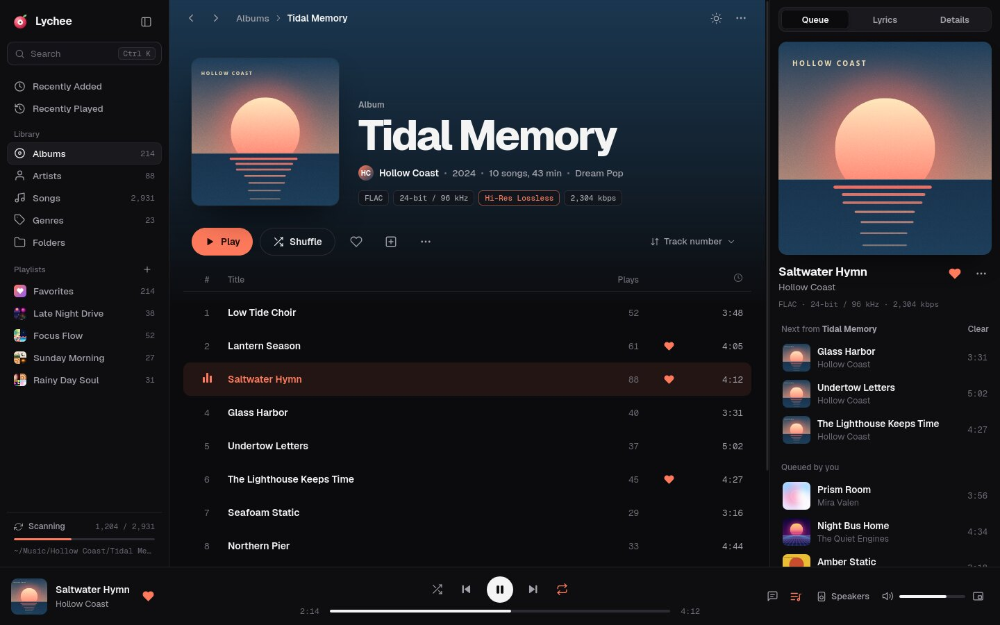
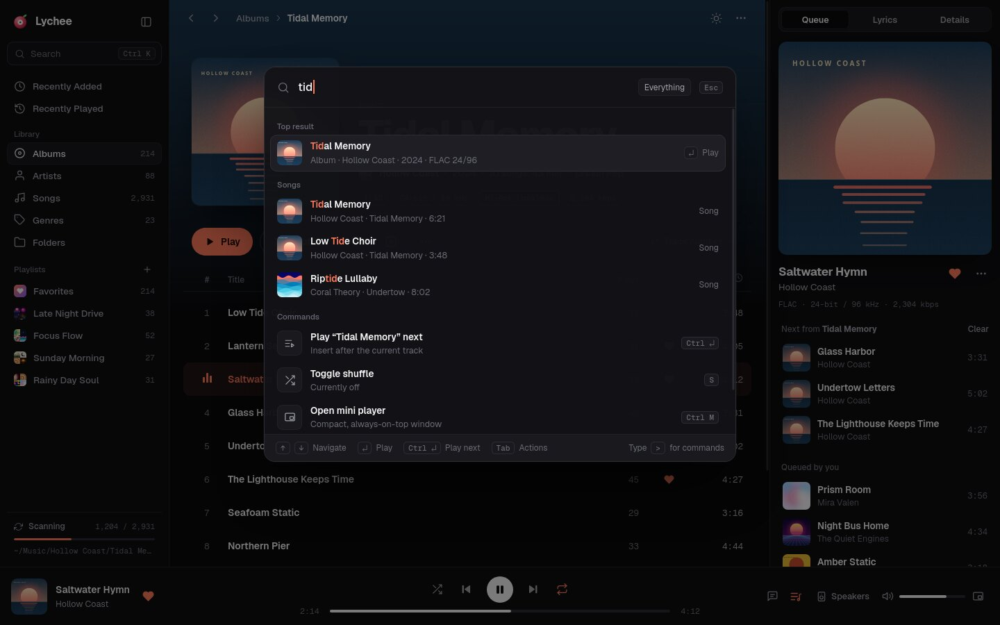
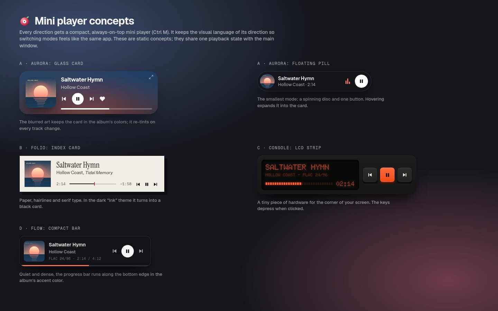

# Lychee: design directions

> **Chosen: D · Flow** (with the Flow mini player). It is implemented in `crates/lychee/ui/`. Streaming-service
> elements were removed for a local player: no "You might also like" row and no "Listen Now" home. The album
> page shows "More by {artist}" only for other albums you own.

Four directions were explored as **interactive HTML prototypes**; the other three (Aurora, Folio and
Console) were removed once Flow was built. Flow and the mini player concepts remain here.

**View them:** open `design/index.html` in a browser (`xdg-open design/index.html` on Linux). An internet connection is needed for the web fonts.

What to try in the prototype:
- Click any album to "play" it.
- `Space` plays and pauses; click a progress bar to seek.
- `Ctrl+K` opens the command palette; `Esc` goes back.
- Resize the window to see the layout adapt.

The prototypes are written in HTML only because it is the fastest medium for exploring design. The app is Rust + Slint (see [`docs/tech-stack.md`](../docs/tech-stack.md)).

---

## Flow: modern pro, keyboard-first

A refined three-pane workhorse (navigation, content, context) with the polish of tools like Linear and Raycast. It has a Ctrl+K command palette for everything and uses dynamic color with restraint.

| Album page | Command palette |
|---|---|
|  |  |

- **Signature details:** Ctrl+K palette for search and commands; album pages with an art-tinted hero; Queue / Lyrics / Details side panel; live library-scan progress; light theme.
- **Trade-offs:** the most familiar, so the least distinctive, and it can drift toward "looks like Spotify". It is the best fit for big libraries and the quickest to build.
- More: [Light theme](previews/flow-light.jpg)

## Mini players

A compact, always-on-top mode (Ctrl+M). The app uses Flow's compact mini player; `mini/index.html` also
keeps the concepts drawn for the other directions.

## Notes

- **Brand.** The logo is a peeled lychee that is also a vinyl record. The red skin is the disc (with faint grooves), the white flesh is the label, and the seed is the spindle.
- **Placeholder content.** Every artist, album, cover and lyric is invented. Covers are generated procedurally (`shared/covers.js`), so no real artwork is used. The same idea can become Lychee's placeholder art for albums without covers.
- **Fonts.** Geist and Geist Mono (SIL Open Font License), served from Google Fonts here and bundled in the app.
- **Files.** `shared/` holds the sample data, the cover generator and icons. `flow/index.html` and `mini/index.html` are the prototypes; `previews/` holds screenshots.
